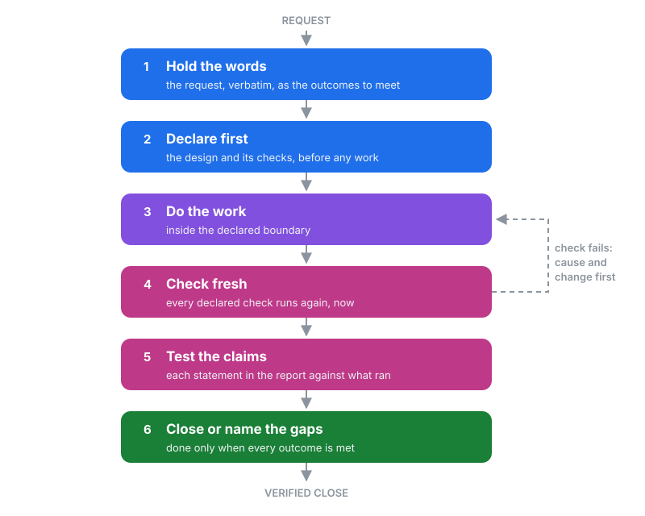

# Terminal Boost

  

**Finish what was asked, prove it with fresh evidence, and never call work done when it is not.**

Terminal Boost is a discipline for AI coding agents. It carries one piece of work from the request to a verified close,
for code, documents, configuration or operations, with any agent and on any system.

  

> This page describes the concept only. The implementation is private and is not published here.

## Why it exists

AI agents are fast, but the same failures keep coming back:

- **The task drifts.** The agent solves an easier problem than the one asked, or quietly widens the scope.
- **"Done" is not done.** A report says tests pass when they were never run, or ran on something else.
- **Old results stand in for new ones.** A check that passed an hour ago is quoted after the code has changed.
- **Retries go blind.** A failing check is run again and again, with nothing changed and no idea why it failed.
- **Claims outgrow the proof.** "Fixed", "verified" and "shipped" appear in the summary with nothing behind them.

Terminal Boost puts a fixed path in front of the work so each of these is caught at the step where it happens.

## The flow

| Stage | What happens | What it prevents |
|---|---|---|
| 1. **Hold the words** | The request is kept in the requester's own words, as the outcomes the work must meet, with the boundary of the work named | Drift, and an easier task replacing the real one |
| 2. **Declare first** | The intended design and the checks that will prove it are stated before any work starts | Proof invented after the fact to fit the result |
| 3. **Do the work** | The work is done inside its declared boundary | Unrelated changes slipping in beside the real one |
| 4. **Check fresh** | Every declared check runs again at the close, on the work as it is now | Stale or reported results counting as proof |
| 5. **Test the claims** | The closing report's own statements are held against what actually ran | Success, landing or verification claims nothing supports |
| 6. **Close or name the gaps** | The work closes only when every outcome is met; otherwise each open gap is named | Partial work presented as finished |

A failed check may run again only with a stated cause and a stated change, so every retry is an experiment rather than
a hope. The rigour scales with the work: a small, clear job takes a light path, and complex work gets a stricter one.

## What you get

- **Answers you can trust.** A closed task means its checks ran and passed at the close.
- **Visible gaps.** What is not finished is named, not hidden in a confident summary.
- **Less waste.** No blind reruns and no work redone because the first attempt solved the wrong problem.
- **Any agent, any system.** It depends on no particular agent, editor, model or host.

## Status

Terminal Boost is in daily use on the author's own work. This folder holds the concept and the flow only; there is no
code to install here.

## Copyright

Copyright (c) 2026 [hu-ghazal](https://github.com/hu-ghazal). The text and the diagram are covered by the repository's
[PolyForm Noncommercial License 1.0.0](../LICENSE). The implementation is not published and is not licensed.
