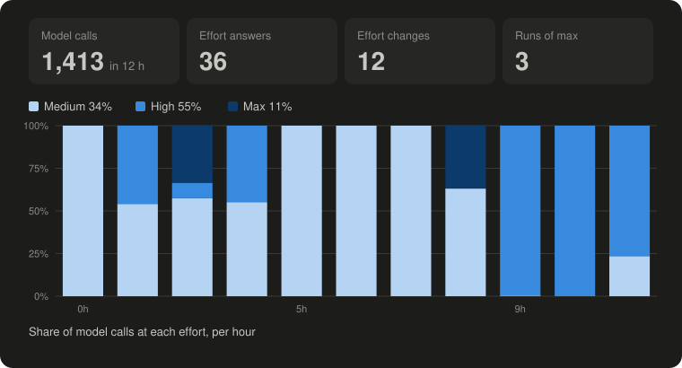
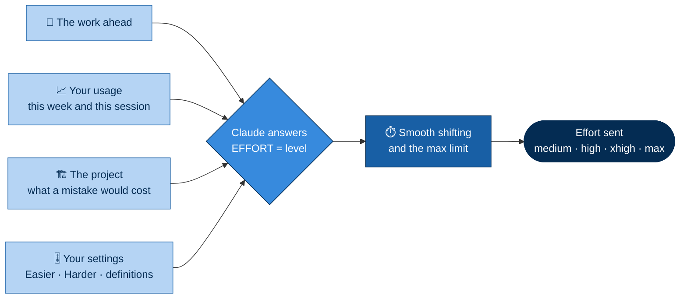

<p align="center">
  
</p>

<p align="center">
  
  <br>
  <sub>Twelve hours of one real session: Claude stays on medium for easy stretches and shifts up to high or max when the work gets hard.</sub>
</p>

<h1 align="center">🏎️ adaptive-effort: automatic reasoning effort for Claude Code</h1>

<p align="center">
  <b>An automatic gearbox for Claude's thinking.</b><br>
  A Claude Code plugin (mod) that lets Claude choose its own reasoning effort, from medium to max, from the work in
  front of it, your usage limits and your project, by clear rules you control.
</p>

<p align="center">
  <a href="CHANGELOG.md"></a>
  
  
  
  
</p>

---

Claude spends more thinking on hard work and less on easy work, like an automatic gearbox that shifts up for a climb
and back down on the straight. You decide how hard each gear is to reach, from a side pane, and the mod keeps the
shifting smooth and the most expensive gear short.

## ✨ Highlights

- 🔴 **Auto mode.** Claude picks its own gear for the work in front of it: medium, high, xhigh or max.
- ⚙️ **Clear shift rules.** Each gear has counted conditions (attempts, files, systems, steps), not vague feelings,
  each in a version for code work and one for any other work. You can rewrite them in Settings.
- 🎚️ **You set the difficulty.** Make max, xhigh or high harder or easier to reach, one step at a time.
- ⏱️ **Smooth shifting.** At least 60 seconds between changes, so the effort never flickers.
- 🛑 **Rev limiter on max.** Ten minutes in a row at most, then back to medium until your next prompt.
- 💰 **Budget aware.** When your weekly usage runs ahead of the week, every gear gets one step harder to reach.
- 🧠 **Weighs cost and project.** Claude sees your usage and its own recent output before each answer, and reads the
  project for what makes a mistake costly.
- 👀 **Watch it live.** A chart in the pane shows the output tokens each gear spends, per 15 minutes, as you work.
- 🔒 **Local and free.** No model calls, no network requests.

## 🔌 Turn it on or off

| To | In the pane | Or type |
|---|---|---|
| **Turn it off** | Press **Turn off**, beside **Settings** at the top | `/adaptive-effort off` |
| **Turn it back on** | Press **Turn on** | `/adaptive-effort on` |
| **See whether it is on** | The top of the pane shows the level now, or **Off** | `/adaptive-effort` |

**Off** means the mod steps aside completely: Claude Code keeps the effort you set yourself, and nothing is added
beside your prompts. **On** lets Claude choose its effort again from the next answer. Your choice is remembered, so new
sessions start the way you left it.

## 🧠 How Claude decides its effort

Beside every prompt, adaptive-effort shows Claude four kinds of information. Claude weighs them and answers with one
line, `echo "EFFORT=high"`, and the mod sends that level to the model for the steps that follow.



| What Claude reads | What it tells Claude |
|---|---|
| 🧩 **The work ahead** | Which level's conditions the coming steps meet: how many files must stay consistent, whether a cause is still unknown, whether something that worked has broken again. |
| 📈 **Your usage** | How much of your weekly limit is used and how much is left, whether you are spending faster than the rest of the week allows, and how much this session has produced lately, level by level. |
| 🏗️ **The project** | Where a mistake costs more: no tests to catch it, production, security or payment code, a shared or public repository, code not read yet. |
| 🎚️ **Your settings** | How hard you made each level to reach, and your own wording of the conditions. |

How the four come together:

- **The work names the level.** When the conditions of more than one level fit, Claude chooses among them by the work
  and your usage.
- **Your usage leans, it never lifts.** Spending faster than your week allows, Claude leans to the lower of the levels
  that fit; with room in the week, a higher level that fits is affordable for hard work. Usage never raises a level the
  work does not call for.
- **The project can add one level,** never up to max on its own.
- **You stay in charge.** Easier and Harder move every count, Settings rewrites the conditions, and the mod keeps the
  shifting smooth.

### 📋 The default conditions

At the default thresholds; **Harder** and **Easier** move the numbers, **Settings** changes the words.

| Level | Code work | Any other work |
|---|---|---|
|  | changing a shared interface (API, schema, data format, config contract) that 2 or more places use | a decision that is hard to undo and that 2 or more other parts depend on |
| | a bug whose cause is still unknown after 2 attempts | a problem whose cause is still unknown after 2 attempts |
| | a change across 2 or more modules or services that must ship together | a change across 2 or more separate parts that must change together |
|  | the same test or check fails a 3rd time | the same problem comes back a 3rd time |
| | a test or check that passed earlier fails again | something believed done turns out wrong |
| | the code behaves differently from what reading it says | a result differs from what was expected |
|  | 3 or more files that must stay consistent | 3 or more pieces that must agree with each other |
| | 5 or more steps, each confirmed by running something (build, test, script) | 5 or more steps, each needing its own check |
|  | anything smaller: a clear next step, such as reading, renames, docs, config values, a fix confirmed on its first run | anything smaller: a clear next step where a mistake is easy to see and undo |

When the work changes, Claude answers again, and drops back as soon as the hard part ends. Nothing here is tied to one
project or language: the conditions and the signals apply to any repository.

The answer is free-standing: other words on the echo line are ignored, so the request can share a line with any other
check you already ask Claude to echo.

### 🛡️ Limits the mod applies

- **60 seconds between changes**, so the effort does not flicker.
- **Max for at most 10 minutes in a row**, then medium until your next prompt.
- **Weekly budget step:** while you are spending faster than your week allows, every count in the rules goes one
  higher, so the higher levels need more reason. The budget never lowers an answer Claude already gave.
- **Subagent note:** over half of the week's limit, a call that starts a native subagent carries a note suggesting a
  lighter helper. It is never blocked.

### 🤖 Models

Opus, Fable and Sonnet 5 and later, from medium to max. Other models and subagent steps are left alone.

## 🎚️ You control your usage, and watch it live

Higher effort means more thinking, and more thinking means more tokens from your usage limit. adaptive-effort leaves
that trade-off in your hands:

- **You set how hard each gear is to reach.** Press **Harder** on Max, Extra high or High and Claude needs more reason
  to use it, so it spends less; press **Easier** and it climbs sooner when the work calls for it.
- **You see what it costs, as it happens.** The pane's chart and table update with every model call, so after a press
  you watch the next answers follow your new setting.
- **Your weekly limit is watched too.** When your usage runs ahead of the week, every gear gets one step harder on its
  own, and the pane says so in amber.

## 🎛️ The Thinking effort pane

The pane opens at session start (`/adaptive-effort pane` brings it to the front). It shows:

- the effort now, as a coloured pill (or **Off**), the **Turn off** / **Turn on** button, a **Settings** button, and one
  line on how Auto works;
- one card each for **Max**, **Extra high** and **High**, with a short definition of the level, your setting when
  you changed it (harder +1, easier -1) and **Easier** / **Harder** buttons, then a card for **Medium**;
- **Save as default** and **Reset to default**;
- the live chart and table below.

### 📊 The live chart

- **Output tokens per 15 minutes, by effort.** One column per quarter hour, stacked by level, starting at the left.
  Output tokens (thinking included) are what the effort changes; the context Claude rereads costs the same at every
  level, so it is not counted.
- **A frame of fixed size.** The tallest column fills the height and 24 hours fit the width, so the chart never grows.
  The terminal gets text rows in place of the drawing.
- **A table of the levels used**, one row each: calls, output per call and share of all output. Levels not used are left
  out.
- **Kept for 24 hours, then deleted.** Each session's chart is saved in Claude Code's local plugin storage at most once
  a minute and when the session ends, so it comes back after an app restart. Older charts are deleted at the next
  session start, so the storage stays small.

Each step **Harder** raises that level's counts by one; **Easier** lowers them (from easier -2 to harder +3). Harder on
Max also raises the number of places a shared interface or decision must reach. A change during a turn reaches Claude
at its next tool call.

### ⚙️ Settings: your own definitions

**Settings** shows every condition's code and general text in a field. Edit one and press Enter: it is saved for every
session and Claude reads it with the next prompt. Write in plain words: a number in a condition is its count, so
typing 5 instead of 4 makes it 5, and Easier, Harder and the weekly budget still move it from there. **Reset definitions to default** brings back the texts above. **Done** returns to the controls.
The mobile app shows the texts but has no fields to edit them yet.

### 🧪 Break to simple (experimental)

At the top of **Settings**, unchecked by default. Checked, Claude adds a quick score out of ten whenever it answers
Max: how well a short plan would turn the work into clear, separate pieces. The mod does the rest with plain arithmetic,
no extra model call:

| Score | Score/10 × 0.9 | Over 0.7? | Effort sent |
|---|---|---|---|
| 8, 9 or 10 | 0.72 to 0.9 | yes | **High** to write the plan, then **Medium** for each piece |
| 7 or less, or no score | 0.63 or less | no | **Max**, as Claude answered |

The pieces are done in the same conversation, not in subagents. The pane shows the last score and what it sent while the
option is on. It is experimental: watch whether split work goes as well as Max before you rely on it.

## ⌨️ Commands

| Command | Does |
|---|---|
| `/adaptive-effort` | Shows the version, the effort, Claude's last answer, the thresholds, the limits and the weekly budget |
| `/adaptive-effort pane` | Opens or raises the pane |
| `/adaptive-effort max harder` | Makes a level harder or easier: `max`, `xhigh` or `high`, then `harder` or `easier` |
| `/adaptive-effort save` | Keeps the current thresholds as the default for new sessions |
| `/adaptive-effort reset` | Returns to the default thresholds |
| `/adaptive-effort off` / `on` | Turns the mod off or on, now and for new sessions (the same as the pane button) |

## 📦 Install

This is a Claude Code plugin with a hooks module (a mod). Plugin support and the mod API depend on your Claude Code
version; check the plugin documentation for your build.

1. Copy the `adaptive-effort` folder into a local plugin marketplace, or load it for one session with:

   ```bash
   claude --plugin-dir path/to/adaptive-effort
   ```

2. Generate the API types for your build (they are not stored in this repository) by running `/plugin-types` in a
   session, pointed at this folder.

## 🚀 First run, and after every update

Claude Code reads a plugin when a session starts. A session that was already open when you installed or updated
adaptive-effort keeps running the build it had, or none, until you reload it.

1. **Load it.** In the open session, run:

   ```text
   /reload-plugins
   ```

   or start a new session.

2. **Check the build.** Run `/adaptive-effort`. Its first line names the version this session loaded, for example
   `version 1.3.0 is on`. An older number, or no reply at all, means the session has not loaded this build yet: go
   back to step 1.

3. **Open the pane.** It opens by itself when a session starts. After a reload, or when it is hidden behind another
   pane, bring it to the front with:

   ```text
   /adaptive-effort pane
   ```

### 🧩 If something does not show

| You see | It means | Do this |
|---|---|---|
| `/adaptive-effort` is an unknown command | The session has not loaded the mod | Run `/reload-plugins` or start a new session; check the plugin is installed and enabled |
| `Thinking effort pane shown.` | The pane is open in front | Nothing to do |
| `Thinking effort pane is open behind another pane: click its "Thinking effort" tab.` | Another pane is in front of it | Click the **Thinking effort** tab |
| `the pane is not drawn here` | This surface draws no side pane | Use the commands below (`/adaptive-effort max harder`, `save`, `reset`); the terminal shows the chart as text rows |
| `No model calls yet since this build loaded.` | The chart has nothing to show yet | Keep working: the chart and table fill in after the next answer |
| An old version number in `/adaptive-effort` | The session still runs the old build | Run `/reload-plugins` |

## 🧪 Test

```bash
claude plugin validate path/to/adaptive-effort
claude plugin test path/to/adaptive-effort
```

The tests cover answer parsing, the hold and the max limit, the budget step and the usage line, the conditions and
your own definitions, the pane, its buttons and Settings, saved defaults, model ranges, the subagent note, and the chart: its buckets, the 24-hour deletion, the table, the fixed frame, and
keeping it across a restart and a plugin reload.

## 🔒 Privacy and cost

The mod makes no model calls and no network requests. It reads the usage limits and token counts Claude Code already
reports, and keeps its settings and each session's chart (for 24 hours) in Claude Code's local plugin storage.

## 📜 License

PolyForm Noncommercial 1.0.0, as the rest of this repository. See [LICENSE](../../LICENSE).

Required Notice: Copyright (c) 2026 hu-ghazal (https://github.com/hu-ghazal)

You are welcome to use, study and adapt adaptive-effort for noncommercial purposes. Please keep the notice above and
the licence with any copy or adaptation you share, and credit the original. Commercial use needs a separate licence:
see the [repository README](../../README.md#license).
